# 8star-prep: Noodvoorraad / Emergency Pantry

[Nederlands](#nederlands) · [English](#english) · [Changelog](CHANGELOG.md)

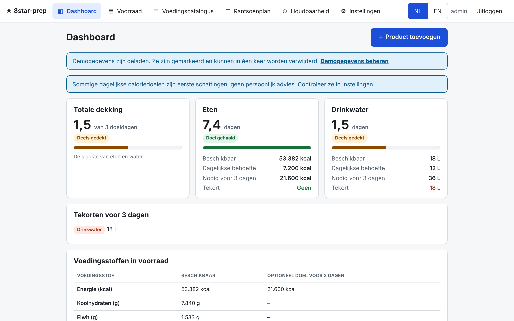

Free, open-source (MIT), self-hosted web app for household emergency supplies: stock, nutrition coverage (kcal, carbs, protein, fat, water), expiry reminders by email and an automatic, deterministic ration plan. No accounts elsewhere, no telemetry, no paid features. Dutch and English.

---

## English

### What it does

- **Dashboard**: days of food (kcal and macros) and water for the chosen target duration (default 3 days, 3 L water per person per day), overall coverage = the lower of food and water, shortages, items needing attention.
- **Inventory**: products with batches (packages, net amount, remaining stock, g/kg/ml/l/pieces, best-before or use-by date), locations, partial packages, drained weight, dry vs prepared, ready-to-eat vs needs cooking, prep water. Add, consume, correct, delete. CSV import (template, preview, validation) and export.
- **Nutrition catalogue**: editable, Dutch and English names, kcal/carbs/protein/fat per 100 g or 100 ml. 53 bundled generic entries (see [THIRD_PARTY.md](THIRD_PARTY.md)), always labelled as estimates. A value from the product label overrides the catalogue. CSV import/export.
- **Ration plan**: day-by-day breakfast, lunch, dinner and snack made only from stock you actually have, with per-household and per-member quantities. Lock or edit meals, regenerate, see exact deficits. Planning reserves stock; only "Mark consumed" deducts it, exactly once. Printable plan and shortage list.
- **Expiry**: overview by status and a daily email digest (SMTP, multiple recipients, each with a language). Sent items are remembered, failures are retried, and a second mail goes out when something actually expires.
- **Settings**: household members (adults/children, editable kcal and optional macro targets), duration, water target, timezone, SMTP, users, demo data.

Important notes shown in the app: calories alone do not make a balanced diet or prove that meals can be cooked. Target values are estimates, not medical or dietary advice. Expired best-before (THT) items are listed separately and not called safe or unsafe. Expired use-by (TGT) items are excluded from totals.

### Screenshots

With the bundled demo data loaded (Settings > Demo data).

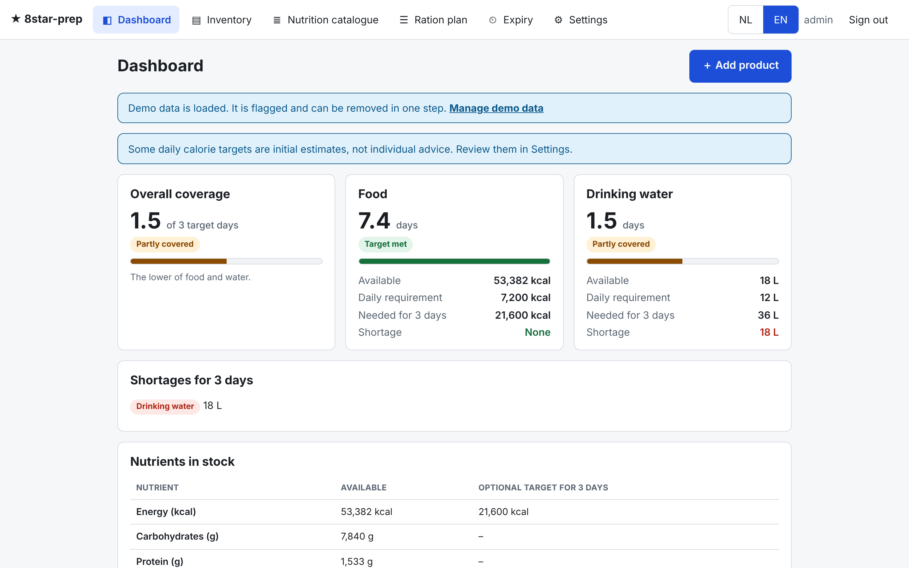

| | |
| --- | --- |
| 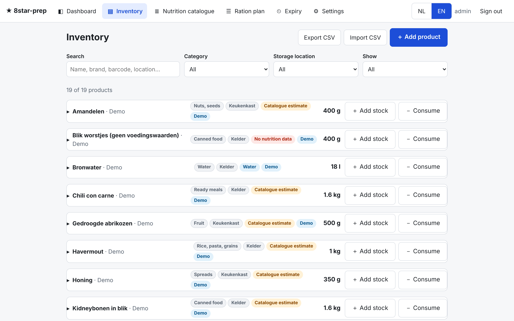<br>Inventory | 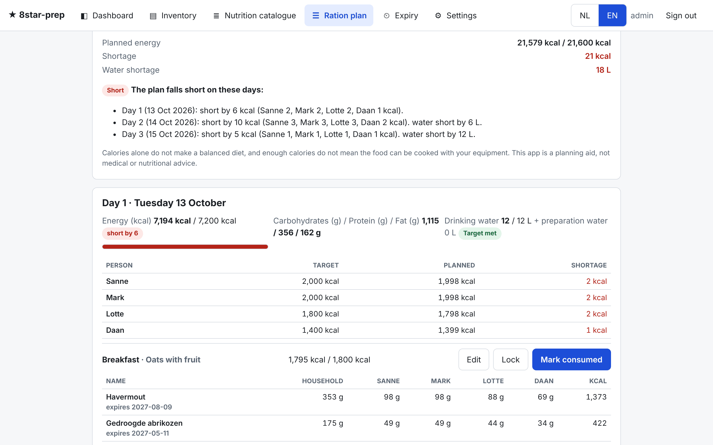<br>Ration plan |
| 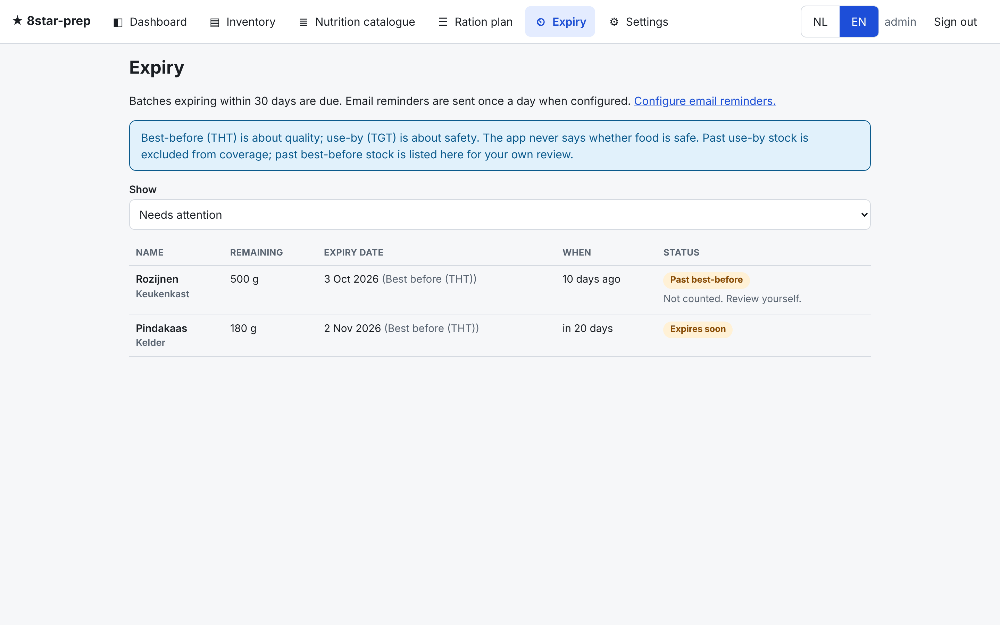<br>Expiry | 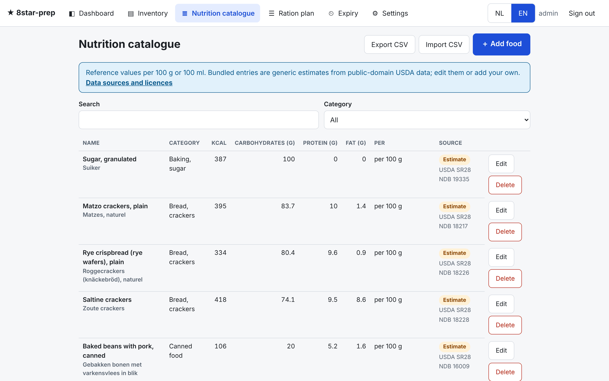<br>Nutrition catalogue |
| 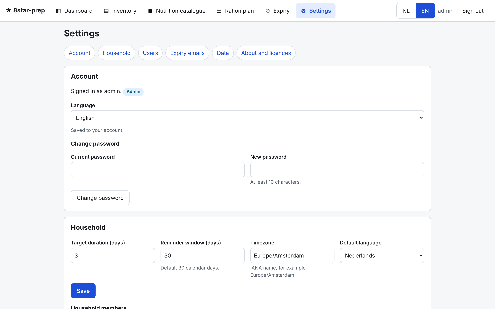<br>Settings |  |

**On a phone:**

<p>
  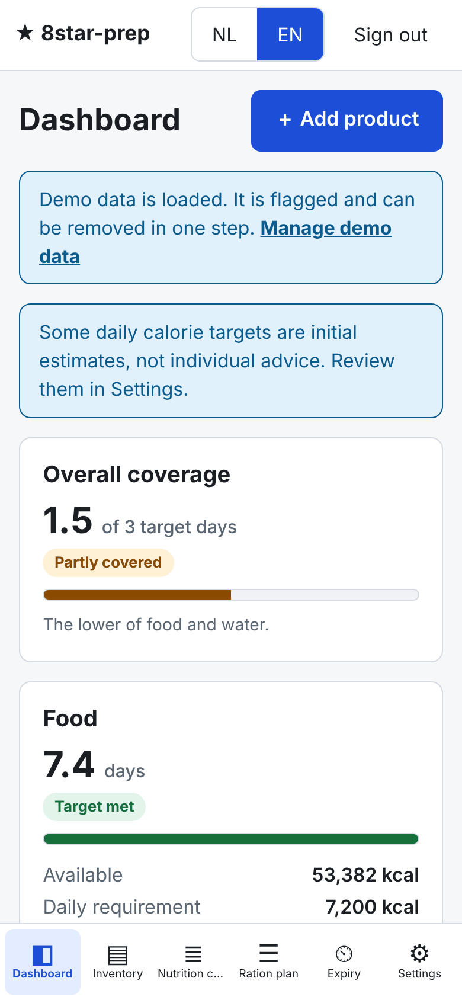
  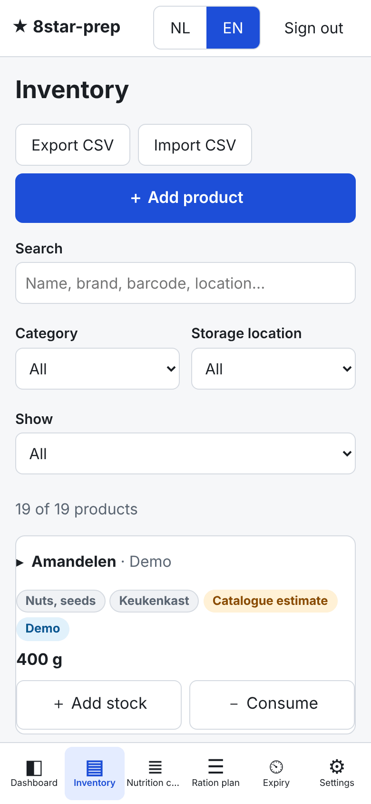
  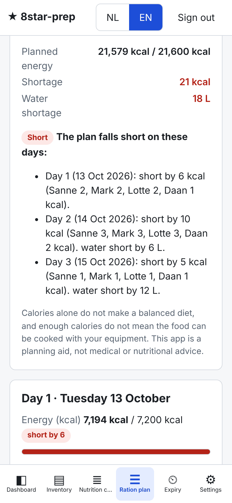
</p>

### Deploy from GitHub with Docker Compose (Dockhand)

1. Open the GitHub repository `TimoM84/8star-prep` (or your own fork).
2. In **Dockhand**, create a new **Stack** and choose **Git repository** as the source.
   - Repository URL: `https://github.com/TimoM84/8star-prep.git`
   - Branch: `main`
   - Compose path: `compose.yaml`
   - For a private repository, add a GitHub deploy key or token in Dockhand.
3. Add these **environment variables** in the stack (or paste them from `.env.example`):
   - `APP_ENCRYPTION_KEY`: required. Generate with `openssl rand -base64 32`. Keep a copy somewhere safe.
   - `ADMIN_USERNAME` and `ADMIN_PASSWORD` (at least 10 characters): create the first admin on first start. Remove `ADMIN_PASSWORD` afterwards.
   - `HOST_PORT`: host port, default `3000`.
   - `TRUSTED_PROXIES`, `COOKIE_SECURE`, `DEFAULT_TIMEZONE`, `DEFAULT_LANGUAGE`: optional, see below.
4. **Deploy** the stack. Dockhand builds the image from the `Dockerfile`; the first build takes a few minutes.
5. Open `http://<server>:<HOST_PORT>`, log in and set up household members under **Settings**.

Without Dockhand, the same thing from a shell:

```bash
git clone https://github.com/TimoM84/8star-prep.git && cd 8star-prep
cp .env.example .env      # fill in APP_ENCRYPTION_KEY and ADMIN_PASSWORD
docker compose up -d --build
```

### Configuration

| Variable | Default | Meaning |
| --- | --- | --- |
| `APP_ENCRYPTION_KEY` | none, required | Encrypts the stored SMTP password (AES-256-GCM). Changing it means re-entering the SMTP password. |
| `ADMIN_USERNAME`, `ADMIN_PASSWORD` | none | Creates the first admin when the database has no users. Ignored afterwards. |
| `HOST_PORT` | `3000` | Published host port. The container always listens on 3000. |
| `TRUSTED_PROXIES` | empty (trust nobody) | Addresses/CIDRs of reverse proxies whose `X-Forwarded-*` headers are trusted, or a hop count like `1`. `true` is refused on purpose. |
| `COOKIE_SECURE` | `auto` | `auto` sets the Secure flag when the connection is HTTPS as seen through trusted proxies. |
| `DEFAULT_TIMEZONE` | `Europe/Amsterdam` | Default for the household; changeable in Settings. |
| `DEFAULT_LANGUAGE` | `nl` | `nl` or `en`; each user can pick their own, which is saved. |

SMTP (host, port, TLS mode, user, password, sender) and recipients are configured in **Settings > Email**, not in environment variables.

### HTTPS and reverse proxy

Run the app behind a reverse proxy (Caddy, Traefik, nginx Proxy Manager) that terminates TLS and forwards to port 3000. Then set `TRUSTED_PROXIES` to the proxy's address or the Docker network range, for example `172.18.0.0/16`, so the app sees the real client IP (for login rate limiting) and the HTTPS scheme (for Secure cookies). Do not expose port 3000 directly to the internet. Never set trusted proxies to everything.

### Backup and restore

All state is in the `prep-data` volume (`/data`): the SQLite database `app.sqlite`, and automatic pre-migration backups in `/data/backups`.

- **Online backup**: `docker compose exec 8star-prep node dist/server/backup.js` writes a consistent copy to `/data/backups/backup-<timestamp>.sqlite`, safe while running. Copy it out with `docker cp 8star-prep:/data/backups/<file> .`
- **Volume backup**: stop the stack and archive the volume, for example `docker run --rm -v 8star-prep_prep-data:/data -v "$PWD":/out alpine tar czf /out/prep-data.tgz -C /data .` (the volume name is prefixed with your stack/project name).
- **Restore**: stop the stack, put the backup file in the volume as `app.sqlite` (remove `app.sqlite-wal` and `app.sqlite-shm` first), start the stack. Use the same `APP_ENCRYPTION_KEY`, otherwise only the SMTP password must be re-entered.
- **Updates and migrations**: redeploy the stack. Database migrations run at start, each in a transaction, after a backup copy in `/data/backups`. If a migration fails, the app does not start and your data is unchanged; restore the backup if needed.

### Security summary

Passwords hashed with scrypt; sessions stored as hashes in the database; HttpOnly, SameSite=Lax cookies; CSRF header check on all changes; login rate limiting per IP and per username (in memory, resets on restart); all APIs require login; admin-only settings; strict CSP and security headers; SMTP password encrypted at rest and never returned by the API or logged; HTML email content escaped; CSV export neutralises spreadsheet formulas; container runs as non-root with a read-only filesystem, no capabilities.

### Real limitations

- Bundled nutrition values come from USDA SR28 generic US foods. They are estimates for typical products, not Dutch NEVO values. Always prefer the label of the product you own.
- The ration plan is template-based and driven by calories. It does not check micronutrients, allergies or taste, and does not prove a balanced diet.
- The plan reserves food but does not deduct water; water is tracked as stock and coverage.
- Login rate limiting is in memory and resets when the container restarts.
- SQLite means one app instance only. There is one active plan per household.
- Whole-gram rounding can leave small kcal shortfalls (shown as deficits, never hidden).
- Email delivery is tested with a mock transport in the test suite; it has not been tested against a live SMTP server. Use the test-email button after configuring.
- The Docker image was not built in the development environment (no Docker daemon). The same build steps were run with Node 22 (`npm ci`, `npm run build`, `npm prune --omit=dev`, start, health check). CI in `.github/workflows/ci.yml` builds the image on GitHub.
- Interface and emails are Dutch and English only.

### Development

```bash
npm ci
npm test            # 82 tests: unit conversions, coverage, planner, API, platform
npm run typecheck
npm run dev:server  # API on :3000 (needs APP_ENCRYPTION_KEY, DATA_DIR=./data-dev)
npm run dev:web     # Vite on :5173, proxies /api
npm run build
```

Pure calculation logic lives in `shared/`, server in `server/`, React UI in `web/`. Translations are in `web/src/i18n/en.ts` and `nl.ts`; a test fails if keys or placeholders differ. Rebuild the bundled catalogue with `npm run catalogue:build` (see THIRD_PARTY.md).

To refresh the screenshots in `docs/screenshots`, start the app, load the demo data as admin, then run `npm i --no-save playwright` and `SHOT_PASSWORD=<admin password> node scripts/screenshots.mjs`.

### Licence

MIT, see [LICENSE](LICENSE). Third-party code and data: [THIRD_PARTY.md](THIRD_PARTY.md).

---

## Nederlands

### Wat het doet

- **Dashboard**: dagen voedsel (kcal en macro's) en water voor de gekozen doelduur (standaard 3 dagen, 3 L water per persoon per dag), totaaldekking = de laagste van voedsel en water, tekorten, aandachtspunten.
- **Voorraad**: producten met partijen (verpakkingen, netto-inhoud, resterende voorraad, g/kg/ml/l/stuks, THT of TGT-datum), locaties, aangebroken verpakkingen, uitlekgewicht, droog of bereid, kant-en-klaar of koken nodig, bereidingswater. Toevoegen, gebruiken, corrigeren, verwijderen. CSV-import (sjabloon, voorbeeldweergave, validatie) en -export.
- **Voedingscatalogus**: aanpasbaar, Nederlandse en Engelse namen, kcal/koolhydraten/eiwit/vet per 100 g of 100 ml. 53 meegeleverde generieke items (zie [THIRD_PARTY.md](THIRD_PARTY.md)), altijd gelabeld als schatting. Een waarde van het etiket gaat boven de catalogus. CSV-import/-export.
- **Rantsoenplan**: dag voor dag ontbijt, lunch, avondeten en tussendoortje, alleen van voorraad die je echt hebt, met hoeveelheden per huishouden en per lid. Maaltijden vergrendelen of aanpassen, opnieuw genereren, exacte tekorten zien. Plannen reserveert voorraad; alleen "Markeer als gebruikt" boekt af, precies één keer. Afdrukbaar plan en tekortenlijst.
- **Houdbaarheid**: overzicht per status en een dagelijkse e-mailsamenvatting (SMTP, meerdere ontvangers met elk een taal). Verstuurde meldingen worden onthouden, mislukte worden opnieuw geprobeerd, en bij het daadwerkelijk verlopen volgt een tweede bericht.
- **Instellingen**: huishoudleden (volwassenen/kinderen, aanpasbare kcal en optionele macrodoelen), duur, waterdoel, tijdzone, SMTP, gebruikers, demodata.

Let op: calorieën alleen zijn geen evenwichtige voeding en bewijzen niet dat maaltijden te bereiden zijn. Doelwaarden zijn schattingen en geen medisch of dieetadvies. Verlopen THT-producten staan apart en worden niet veilig of onveilig genoemd. Verlopen TGT-producten tellen niet mee.

### Schermafbeeldingen

Met de meegeleverde demodata geladen (Instellingen > Demogegevens).


| | |
| --- | --- |
| 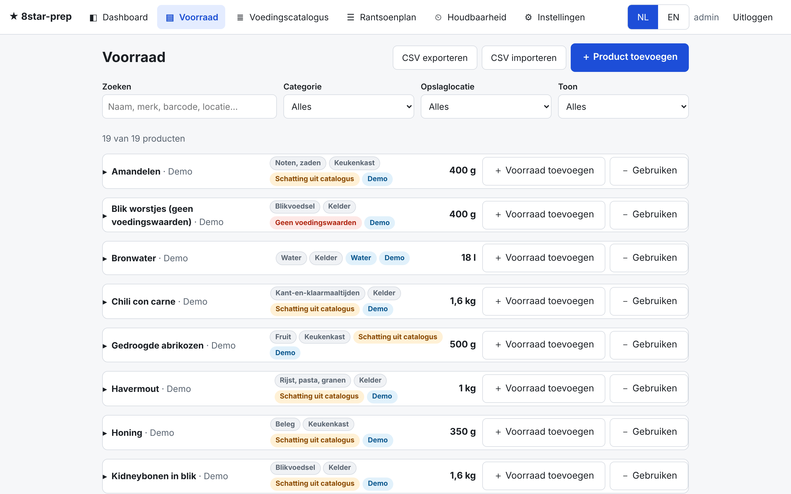<br>Voorraad | 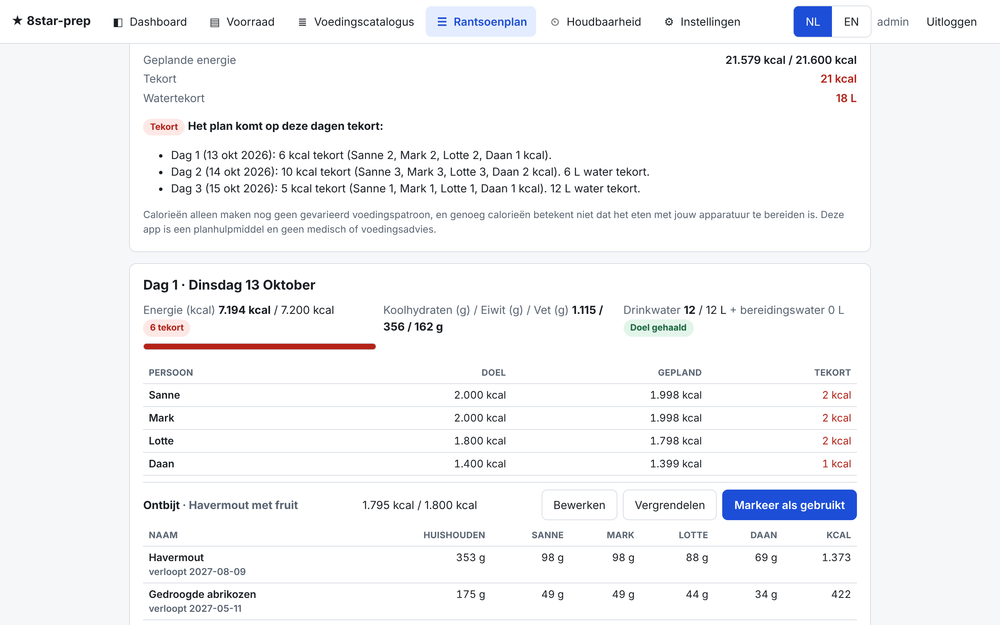<br>Rantsoenplan |
| 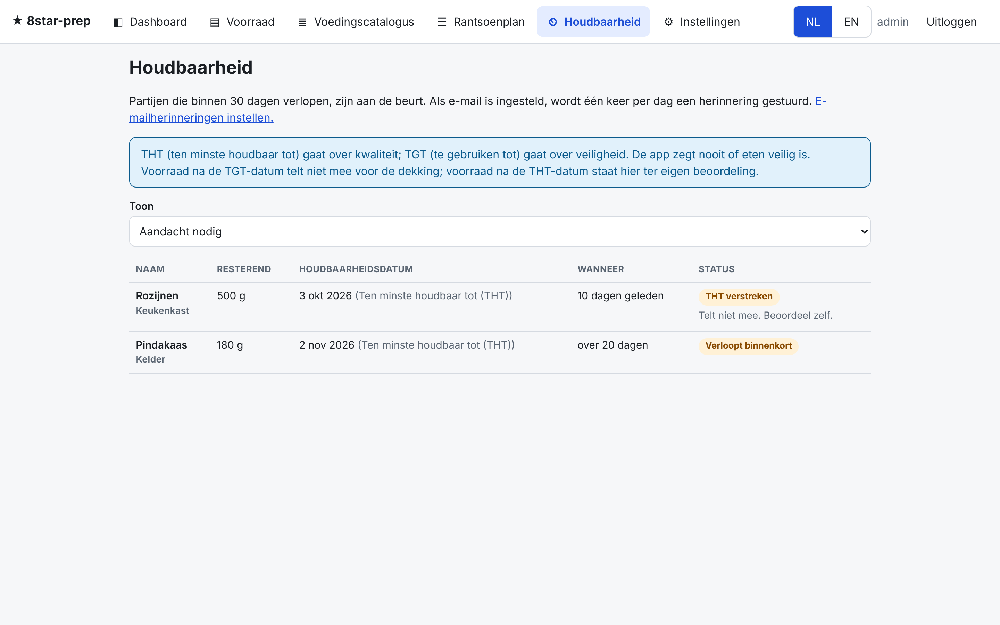<br>Houdbaarheid | 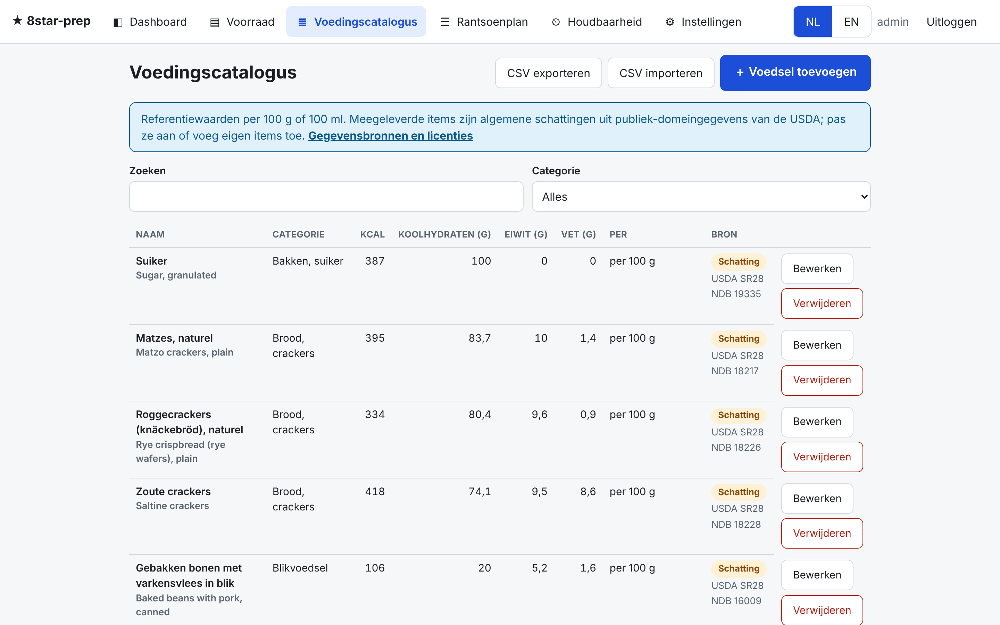<br>Voedingscatalogus |
| 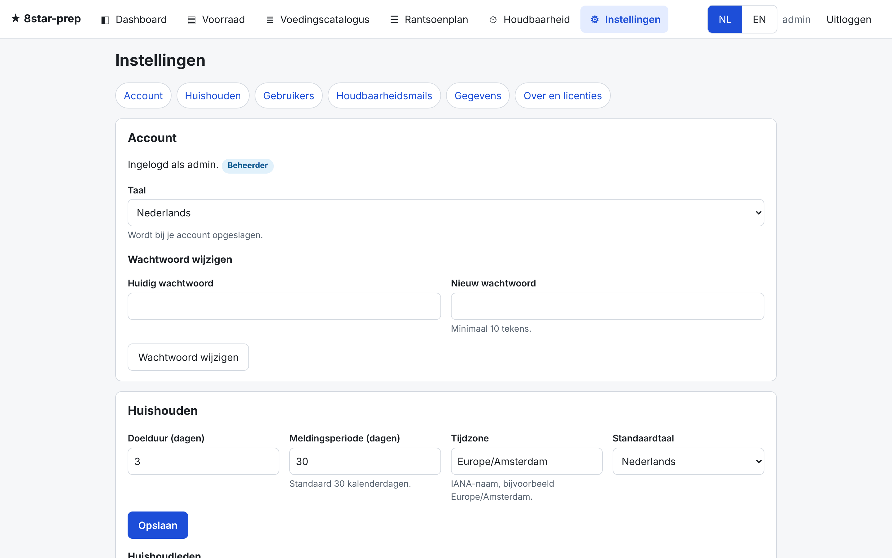<br>Instellingen |  |

**Op de telefoon:**

<p>
  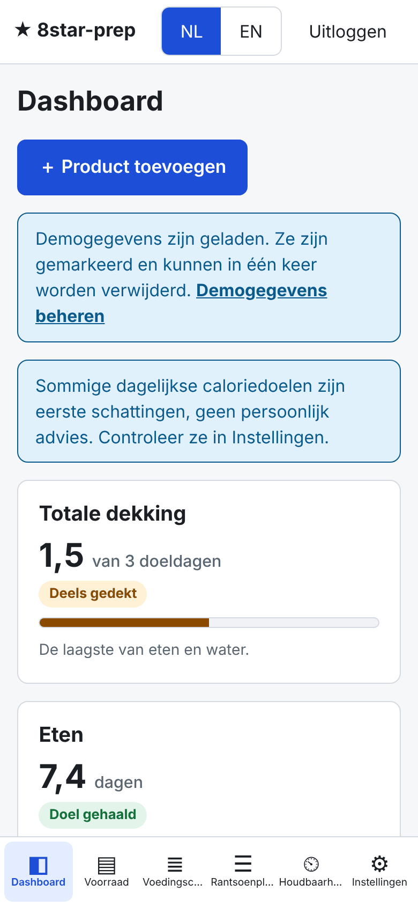
  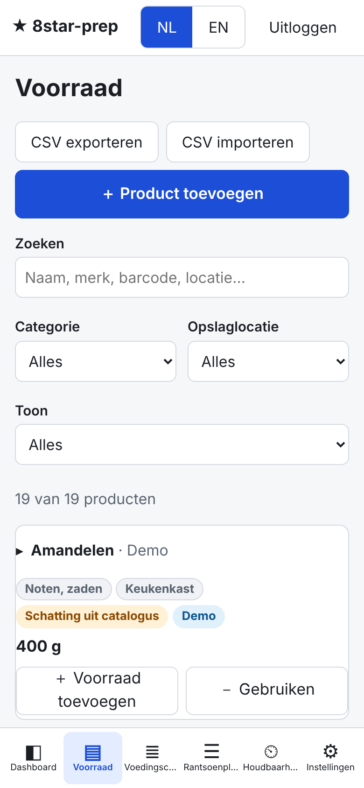
  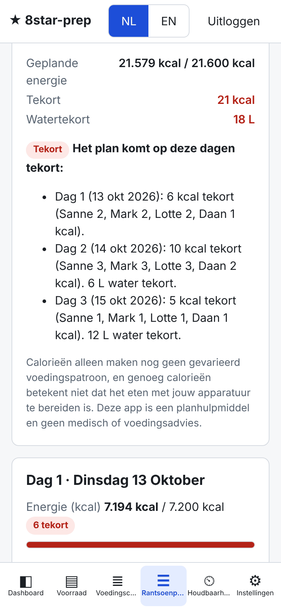
</p>

### Uitrollen vanaf GitHub met Docker Compose (Dockhand)

1. Open de GitHub-repository `TimoM84/8star-prep` (of je eigen fork).
2. Maak in **Dockhand** een nieuwe **Stack** met **Git repository** als bron.
   - Repository-URL: `https://github.com/TimoM84/8star-prep.git`
   - Branch: `main`
   - Compose-pad: `compose.yaml`
   - Bij een privé-repository voeg je in Dockhand een deploy key of token toe.
3. Voeg deze **omgevingsvariabelen** toe aan de stack (of plak ze uit `.env.example`):
   - `APP_ENCRYPTION_KEY`: verplicht. Maak er een met `openssl rand -base64 32` en bewaar een kopie veilig.
   - `ADMIN_USERNAME` en `ADMIN_PASSWORD` (minimaal 10 tekens): maken bij de eerste start de eerste beheerder. Verwijder `ADMIN_PASSWORD` daarna.
   - `HOST_PORT`: poort op de host, standaard `3000`.
   - `TRUSTED_PROXIES`, `COOKIE_SECURE`, `DEFAULT_TIMEZONE`, `DEFAULT_LANGUAGE`: optioneel, zie de tabel hierboven.
4. **Deploy** de stack. Dockhand bouwt het image met de `Dockerfile`; de eerste build duurt enkele minuten.
5. Open `http://<server>:<HOST_PORT>`, log in en stel onder **Instellingen** de huishoudleden in.

Zonder Dockhand, vanuit een shell:

```bash
git clone https://github.com/TimoM84/8star-prep.git && cd 8star-prep
cp .env.example .env      # vul APP_ENCRYPTION_KEY en ADMIN_PASSWORD in
docker compose up -d --build
```

### HTTPS en reverse proxy

Draai de app achter een reverse proxy (Caddy, Traefik, nginx Proxy Manager) die TLS afhandelt en doorstuurt naar poort 3000. Zet daarna `TRUSTED_PROXIES` op het adres van de proxy of het Docker-netwerkbereik, bijvoorbeeld `172.18.0.0/16`, zodat de app het echte client-IP (voor de inlogbeperking) en het HTTPS-protocol (voor Secure-cookies) ziet. Zet poort 3000 niet direct open op internet. Vertrouw nooit alle proxies.

### Back-up en herstel

Alle gegevens staan in het volume `prep-data` (`/data`): de SQLite-database `app.sqlite` en automatische back-ups vóór migraties in `/data/backups`.

- **Online back-up**: `docker compose exec 8star-prep node dist/server/backup.js` schrijft een consistente kopie naar `/data/backups/backup-<tijdstip>.sqlite`, veilig tijdens draaien. Kopieer die weg met `docker cp 8star-prep:/data/backups/<bestand> .`
- **Volume-back-up**: stop de stack en archiveer het volume, bijvoorbeeld `docker run --rm -v 8star-prep_prep-data:/data -v "$PWD":/out alpine tar czf /out/prep-data.tgz -C /data .` (de volumenaam begint met de naam van je stack/project).
- **Herstel**: stop de stack, zet het back-upbestand als `app.sqlite` in het volume (verwijder eerst `app.sqlite-wal` en `app.sqlite-shm`) en start de stack. Gebruik dezelfde `APP_ENCRYPTION_KEY`, anders hoeft alleen het SMTP-wachtwoord opnieuw ingevoerd te worden.
- **Updates en migraties**: deploy de stack opnieuw. Migraties draaien bij het starten, elk in een transactie, na een back-up in `/data/backups`. Mislukt een migratie, dan start de app niet en blijven je gegevens ongewijzigd; herstel zo nodig de back-up.

### Beveiliging

Wachtwoorden met scrypt gehasht; sessies als hash opgeslagen; HttpOnly SameSite=Lax-cookies; CSRF-controle op alle wijzigingen; inlogbeperking per IP en per gebruikersnaam (in het geheugen, wordt na herstart gewist); alle API's vereisen inloggen; instellingen alleen voor beheerders; strikte CSP; SMTP-wachtwoord versleuteld opgeslagen en nooit teruggegeven of gelogd; e-mailinhoud geëscaped; CSV-export neutraliseert spreadsheetformules; container draait als niet-root met alleen-lezen bestandssysteem en zonder capabilities.

### Echte beperkingen

- De meegeleverde voedingswaarden komen uit USDA SR28 (generieke Amerikaanse producten). Het zijn schattingen, geen Nederlandse NEVO-waarden. Gebruik bij voorkeur het etiket van je eigen product.
- Het rantsoenplan werkt met sjablonen en calorieën. Het controleert geen micronutriënten, allergieën of smaak en bewijst geen evenwichtige voeding.
- Het plan reserveert voedsel maar boekt geen water af; water telt als voorraad en dekking.
- De inlogbeperking zit in het geheugen en wordt gewist bij een herstart.
- SQLite betekent één app-instantie. Er is één actief plan per huishouden.
- Afronding op hele grammen kan kleine kcal-tekorten geven (zichtbaar als tekort, nooit verborgen).
- E-mailverzending is getest met een nep-transport; niet met een echte SMTP-server. Gebruik na het instellen de testmail-knop.
- Het Docker-image is in de ontwikkelomgeving niet gebouwd (geen Docker-daemon). Dezelfde stappen zijn met Node 22 doorlopen (`npm ci`, `npm run build`, `npm prune --omit=dev`, start, healthcheck). CI in `.github/workflows/ci.yml` bouwt het image op GitHub.
- Interface en e-mails zijn alleen Nederlands en Engels.

### Licentie

MIT, zie [LICENSE](LICENSE). Code en data van derden: [THIRD_PARTY.md](THIRD_PARTY.md).
